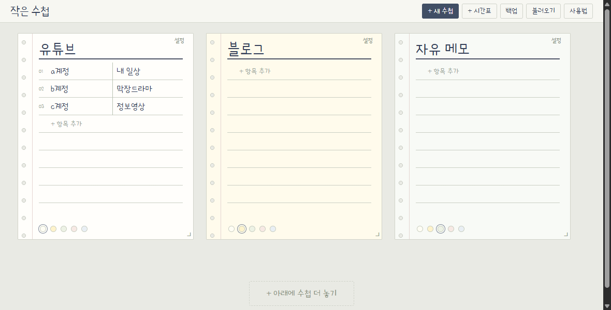

# 작은수첩

펀치 줄노트에 메모와 하루 시간표를 자유롭게 배치하는 작은 웹앱입니다.

**[바로 사용하기](https://little-notebook.vercel.app/)** · moeum

## 다운로드해서 사용하기

1. 이 저장소의 `작은수첩_v1.0.html` 파일을 다운로드합니다. 파일 화면 오른쪽 위의 **Download raw file**을 사용하세요.
2. 다운로드한 HTML을 Chrome 또는 Edge에서 엽니다. 설치나 별도 서버 없이 사용할 수 있습니다.
3. 파일 이름과 저장 위치를 정한 다음 사용하세요. 사용 중 이름이나 위치를 바꾸기 전에는 반드시 JSON 백업을 받으세요.

## 주요 기능

- 수첩을 자유롭게 이동하고 크기 조절
- 1·2·3단 입력, 칸 너비 조절, 항목 순서 이동
- Enter로 다음 칸 이동, 위 방향키로 위 항목 이동
- 항목 우클릭으로 중요 표시
- 24시간 타임라인과 일정 색상, 색상별 시간 합계
- JSON 백업과 불러오기
- 좁은 화면에서는 수첩을 세로로 표시

## 저장과 백업에 꼭 알아둘 점

- 기록은 서버가 아니라 **현재 브라우저의 localStorage**에 저장됩니다.
- 웹 버전과 다운로드 버전, 다른 브라우저나 기기 사이에 기록이 자동 동기화되지 않습니다.
- 다른 환경으로 옮길 때는 상단 **백업**으로 JSON을 저장한 뒤 **불러오기**를 사용하세요.
- 불러오기는 기존 수첩과 병합하며, 같은 ID의 수첩과 항목은 백업 내용으로 교체됩니다.
- 브라우저 데이터를 삭제하거나 비공개 창을 닫으면 기록이 사라질 수 있습니다. 중요한 기록은 정기적으로 백업하세요.
- 다운로드한 HTML은 직접 실행하는 앱입니다. 브라우저에서 소스 코드만 보인다면 HTML 파일로 저장했는지 확인하세요.

## 파일 구성

- `작은수첩_v1.0.html`: CSS·JavaScript·글꼴이 포함된 실행 파일이자 소스
- `화면예시.png`: 초기 예시 화면
- `OFL-PoorStory.txt`: 포함된 Poor Story 글꼴 라이선스

빌드 과정이나 외부 패키지 설치는 필요하지 않습니다. 파일명 `v1.0`은 기존 로컬 저장 연결을 보존하기 위한 이름이며, 현재 데이터 스키마는 6입니다.

## 글꼴과 이용 조건

Poor Story 글꼴은 YoonDesign의 SIL Open Font License 1.1에 따라 포함됩니다. 자세한 내용은 `OFL-PoorStory.txt`를 확인하세요. 이 글꼴 라이선스가 앱 코드 전체에 적용되는 것은 아닙니다. 앱 소스의 별도 오픈소스 라이선스는 아직 지정하지 않았습니다.